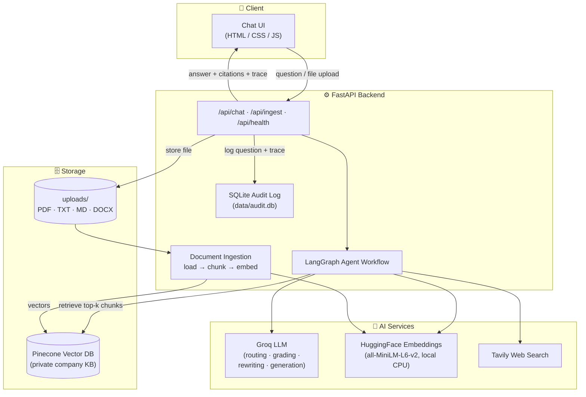
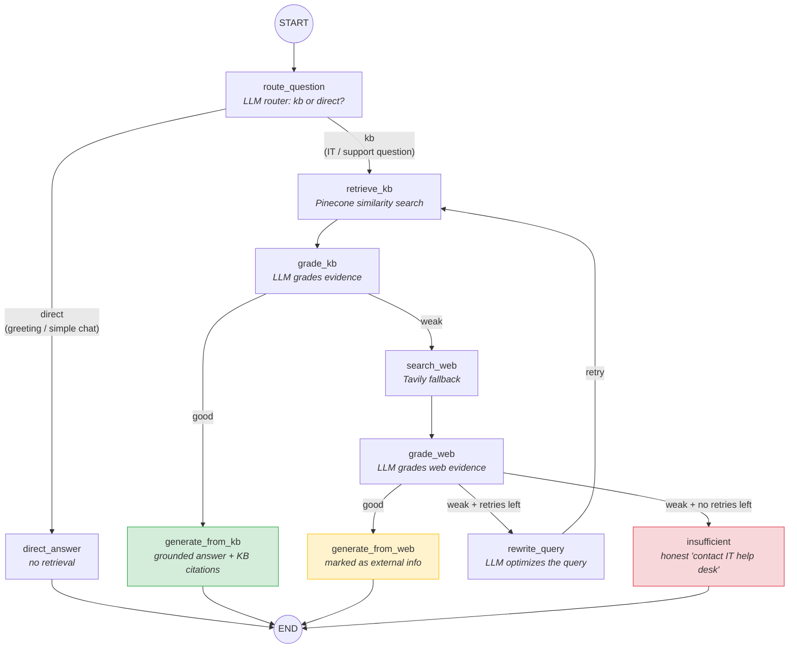
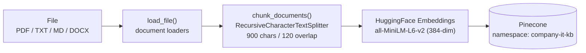

# 🏢 Enterprise IT Support — Agentic RAG Copilot

An **Agentic Retrieval-Augmented Generation (RAG)** copilot that answers employee IT-support questions from a **trusted private company knowledge base first**, grades the retrieved evidence, falls back to **web search** only when needed, rewrites weak queries and retries — and always returns its answer with **citations and a full decision trace**.

> 🚀 **Live Demo:** [Open Enterprise IT Support Copilot](https://enterprise-it-support-agentic-rag-copilot-nuub.onrender.com) · [API Health](https://enterprise-it-support-agentic-rag-copilot-nuub.onrender.com/api/health) · [API Docs](https://enterprise-it-support-agentic-rag-copilot-nuub.onrender.com/docs)

> Built as an **FDE (Forward Deployed Engineer)** project for the fictional customer **NovaRetail** (3,000 employees). Full scenario: [`docs/FDE_Agentic_RAG_Problem_Statement.pdf`](docs/FDE_Agentic_RAG_Problem_Statement.pdf)

---

## 📖 Table of Contents

1. [Overview](#-overview)
2. [About This Project](#-about-this-project)
3. [The Business Problem It Solves](#-the-business-problem-it-solves)
4. [Why "Agentic" RAG and Not Simple RAG?](#-why-agentic-rag-and-not-simple-rag)
5. [Business Use Cases](#-business-use-cases)
6. [Architecture & Flow Diagrams (Mermaid)](#-architecture--flow-diagrams-mermaid)
7. [Libraries & Technologies Used](#-libraries--technologies-used)
8. [Folder Structure](#-folder-structure)
9. [Getting Started](#-getting-started)
10. [API Reference](#-api-reference)
11. [Configuration (Environment Variables)](#-configuration-environment-variables)
12. [Audit Logging & Transparency](#-audit-logging--transparency)
13. [Docker Deployment](#-docker-deployment)
14. [Roadmap / Future Improvements](#-roadmap--future-improvements)

---

## 🎯 Overview

|                       |                                                                                                                                            |
| --------------------- | ------------------------------------------------------------------------------------------------------------------------------------------ |
| **Project**           | Enterprise IT Support Agentic RAG Copilot                                                                                                  |
| **Live deployment**   | [https://enterprise-it-support-agentic-rag-copilot-nuub.onrender.com](https://enterprise-it-support-agentic-rag-copilot-nuub.onrender.com) |
| **Customer scenario** | NovaRetail (fictional), 3,000 employees, internal IT support                                                                               |
| **Problem**           | Repetitive IT tickets even though answers already exist in the company KB                                                                  |
| **Solution**          | An agentic RAG pipeline: route → retrieve → grade → (web fallback) → rewrite/retry → grounded answer + citations + trace                   |
| **Stack**             | FastAPI + LangGraph + Groq LLM + Pinecone + HuggingFace embeddings + Tavily + SQLite + HTML/CSS/JS UI                                      |
| **Cost profile**      | **Free-tier friendly** — Groq (free tier), local CPU embeddings (no API cost), Pinecone/Tavily free tiers                                  |

---

## 📌 About This Project

NovaRetail has a large internal IT knowledge base — VPN instructions, password rules, MFA policies, software-installation rules, laptop troubleshooting guides, and service-desk runbooks. Yet employees keep raising repetitive tickets because:

- Keyword search returns _many documents_ instead of _one clear answer_.
- A naive chatbot may **hallucinate** confidently even without reliable company data.
- Some questions depend on **current public information** not yet in the private KB.

This project solves that with an **evidence-driven agentic workflow**:

1. An employee asks a question (via the chat UI or REST API).
2. **LangGraph routes** the request — simple greetings get a direct answer; IT/support questions enter the RAG pipeline.
3. Relevant chunks are retrieved from the **private Pinecone knowledge base**.
4. An **LLM grader** evaluates whether the retrieved evidence is strong enough.
   - ✅ **GOOD** → generate a grounded answer _from company knowledge only_, with citations.
   - ⚠️ **WEAK** → fall back to **Tavily web search**, then grade the web evidence too.
5. If web evidence is also weak, the query is **rewritten and retried** (bounded by `MAX_RETRIES`); if it is still insufficient, the copilot honestly says so instead of making things up.
6. The final response includes the **answer, which source was used, citations, and a step-by-step decision trace** — everything is also written to a **SQLite audit log**.

### Example Walkthroughs (from the problem statement)

| Example                                 | Question                                                | What the agent does                                                                                                                          |
| --------------------------------------- | ------------------------------------------------------- | -------------------------------------------------------------------------------------------------------------------------------------------- |
| **#1 — Answer in private KB**           | _"How do I connect to the company VPN from home?"_      | Retrieves VPN handbook chunks → grades them **good** → answers from company KB with citations. No web search.                                |
| **#2 — Private knowledge insufficient** | _"What is the latest Microsoft Teams outage guidance?"_ | Private retrieval grades **weak** → Tavily web search → web evidence graded → grounded answer, clearly marked as _external web information_. |

## 💼 The Business Problem It Solves

> **Core business challenge:** Employees need fast answers, but the company needs those answers to be _grounded, trustworthy, transparent, and based on private company knowledge whenever possible_.

**Expected business value:**

- 📉 **Reduce repetitive IT support tickets** — answers are self-service and instant.
- ⚡ **Faster answers for employees** — one clear answer instead of ten documents.
- 🔒 **Private company knowledge first** — trusted internal docs are preferred over public info.
- 🛡️ **Fewer hallucinations** — every answer is generated _only after_ an LLM grades the evidence.
- 🌐 **Controlled web fallback** — knowledge gaps are handled explicitly, never silently.
- 🔍 **Inspectable AI decisions** — every response carries its source and workflow trace; everything is audit-logged.
- 📈 **A KB that grows** — authorized staff can ingest new PDF/TXT/MD/DOCX documents via API.

---

## 🧠 Why "Agentic" RAG and Not Simple RAG?

| Simple RAG (`Question → Retrieve → Generate`)  | Agentic RAG (this project)                                               |
| ---------------------------------------------- | ------------------------------------------------------------------------ |
| Retrieves once                                 | Retrieves, **grades**, and **retries** when necessary                    |
| Fixed, linear flow                             | **Conditional LangGraph routing** at every step                          |
| Generates right after retrieval                | Generates **only after evidence evaluation**                             |
| Uses only the private KB                       | **Private KB first**, web fallback when needed                           |
| Weak/irrelevant chunks still produce an answer | Weak evidence → query rewrite → retry → honest _"insufficient evidence"_ |
| No visibility into decisions                   | Full **trace + citations + audit log**                                   |

---

## 🏭 Business Use Cases

- **Internal IT help-desk deflection** — first line of support before a human agent.
- **Employee onboarding** — "how do I…?" questions about company systems and policies.
- **Security & compliance policy Q&A** — password, MFA, and software-installation policies answered only from approved documents.
- **Incident awareness** — current vendor outage guidance via controlled web fallback.
- **Pattern for other departments** — HR, Legal, Finance can reuse the same pipeline with their own KBs (just change the Pinecone namespace and documents).
- **Knowledge-base health monitoring** — audit logs reveal which questions consistently hit "insufficient evidence", telling IT which documents to write next.

## 🔀 Architecture & Flow Diagrams (Mermaid)

### End-to-End System Architecture



### Agentic Decision Workflow (LangGraph)

This is the heart of the project — the actual graph built in `app/rag/workflow.py`:



### Document Ingestion Flow



## 🧰 Libraries & Technologies Used

### Core API & Web Layer

| Library                          | Purpose                                                        |
| -------------------------------- | -------------------------------------------------------------- |
| **FastAPI**                      | REST API framework (`/api/chat`, `/api/ingest`, `/api/health`) |
| **Uvicorn**                      | ASGI server (hot-reload dev server via `run.py`)               |
| **Pydantic / pydantic-settings** | Request validation & `.env`-driven typed configuration         |
| **Jinja2**                       | Server-side rendering of the chat UI (`templates/index.html`)  |
| **python-dotenv**                | Early `.env` loading so API keys exist before module init      |
| **python-multipart**             | File-upload support for `/api/ingest`                          |

### Agentic RAG Core

| Library                                           | Purpose                                                        |
| ------------------------------------------------- | -------------------------------------------------------------- |
| **LangGraph**                                     | Stateful agent workflow — routing, conditional edges, retries  |
| **LangChain / langchain-core**                    | Document model, prompt/LLM abstractions                        |
| **langchain-groq**                                | Groq LLM integration (routing, grading, rewriting, generation) |
| **langchain-huggingface + sentence-transformers** | Free, local CPU embeddings (`all-MiniLM-L6-v2`, 384-dim)       |
| **langchain-pinecone + pinecone**                 | Serverless vector DB for the private KB                        |
| **langchain-tavily + tavily-python**              | Web-search fallback tool                                       |
| **langchain-text-splitters**                      | Recursive chunking (900 chars, 120 overlap)                    |
| **langchain-community**                           | PDF/TXT document loaders                                       |

### Storage, Documents & Ops

| Library                                  | Purpose                                               |
| ---------------------------------------- | ----------------------------------------------------- |
| **pypdf / python-docx / beautifulsoup4** | PDF, DOCX and HTML text extraction                    |
| **SQLite (stdlib)**                      | Zero-dependency audit logging of every query + trace  |
| **Docker**                               | Container packaging with health check                 |
| **Ruff**                                 | Linting / formatting (`pyproject.toml`)               |
| **uv / pip**                             | Dependency management (`uv.lock`, `requirements.txt`) |

### Resilience Features Built In

- **Model fallback** — if the primary Groq model is retired (`model_not_found`), requests retry with the fallback model (`llama-3.1-8b-instant`).
- **Structured-output fallback** — grading calls try tool-calling → JSON mode → manual JSON parsing, so quirky models (e.g. `gpt-oss`) still work.
- **Bounded retries** — `MAX_RETRIES` prevents infinite rewrite loops.
- **Context clamping** — prompts capped at ~12k chars to respect free-tier context limits.

## 📁 Folder Structure

```text
Enterprise-IT-Support-Agentic-RAG-Copilot/
├── app/                          # Main application package
│   ├── api/
│   │   └── routes.py             # REST endpoints: /api/chat, /api/ingest, /api/health
│   ├── core/
│   │   ├── config.py             # Typed settings via pydantic-settings (.env driven)
│   │   └── logging.py            # Central logging configuration
│   ├── rag/                      # The agentic RAG engine
│   │   ├── state.py              # AgentState (TypedDict), RouteDecision & EvidenceGrade schemas
│   │   ├── vectorstore.py        # Pinecone index lifecycle + embeddings + retriever
│   │   └── workflow.py           # LangGraph graph: route → retrieve → grade → web → rewrite → generate
│   ├── services/
│   │   ├── audit.py              # SQLite audit logging (question, source, trace)
│   │   └── ingestion.py          # File loaders (PDF/TXT/MD/DOCX) + chunking
│   └── main.py                   # FastAPI app factory, lifespan, static & template mounting
├── static/
│   ├── css/style.css             # Chat UI styling
│   └── js/app.js                 # Chat UI logic (calls /api/chat, renders trace & citations)
├── templates/
│   └── index.html                # Jinja2 chat page
├── data/
│   ├── sample_kb/                # Seed knowledge base
│   │   ├── company_it_handbook.md
│   │   └── service_desk_runbook.md
│   └── audit.db                  # SQLite audit log (auto-created)
├── docs/
│   └── FDE_Agentic_RAG_Problem_Statement.pdf   # Original problem statement & scenario
├── uploads/                      # Files uploaded via /api/ingest
├── ingest_sample_kb.py           # CLI: index data/sample_kb/* into Pinecone
├── run.py                        # Dev server entrypoint (uvicorn + selective hot reload)
├── main.py                       # Alternate entrypoint
├── Dockerfile                    # Production container (health-checked)
├── requirements.txt              # Pinned dependencies
├── pyproject.toml / uv.lock      # Project metadata & lockfile
├── .env.example                  # Template for required API keys
└── README.md                     # ← You are here
```

## 🚀 Getting Started

### Try the Live Deployment

- **Chat UI:** [https://enterprise-it-support-agentic-rag-copilot-nuub.onrender.com](https://enterprise-it-support-agentic-rag-copilot-nuub.onrender.com)
- **Health check:** [https://enterprise-it-support-agentic-rag-copilot-nuub.onrender.com/api/health](https://enterprise-it-support-agentic-rag-copilot-nuub.onrender.com/api/health)
- **API documentation:** [https://enterprise-it-support-agentic-rag-copilot-nuub.onrender.com/docs](https://enterprise-it-support-agentic-rag-copilot-nuub.onrender.com/docs) _(if Swagger docs are enabled in the deployed environment)_

The live service depends on its configured environment variables and external services (Groq, Pinecone, and Tavily). If the app is sleeping or the health check fails, check the Render service status and logs.

### Run Locally

### Prerequisites

- Python **3.12+**
- API keys (all have free tiers):
  - [Groq](https://console.groq.com) — LLM
  - [Pinecone](https://www.pinecone.io) — vector DB
  - [Tavily](https://tavily.com) — web search fallback

### 1. Clone & set up environment

```bash
git clone https://github.com/Surajgupta001/Enterprise-IT-Support-Agentic-RAG-Copilot.git
cd Enterprise-IT-Support-Agentic-RAG-Copilot

python -m venv .venv
# Windows (PowerShell)
.venv\Scripts\Activate.ps1
# macOS / Linux
source .venv/bin/activate

pip install -r requirements.txt
```

### 2. Configure environment variables

```bash
cp .env.example .env
# then edit .env and fill in:
#   GROQ_API_KEY=...
#   PINECONE_API_KEY=...
#   TAVILY_API_KEY=...
```

### 3. Seed the knowledge base

```bash
python ingest_sample_kb.py
# → Indexed 2 files -> N chunks -> N Pinecone vectors
```

### 4. Run the server

```bash
python run.py
# → Uvicorn running on http://127.0.0.1:8080
```

### 5. Use it

- Open **http://127.0.0.1:8080** in a browser and chat, e.g. _"What is our password reset policy?"_
- Or hit the API directly:

```bash
curl -X POST http://127.0.0.1:8080/api/chat \
  -H "Content-Type: application/json" \
  -d '{"question": "How do I connect to the company VPN from home?"}'

# Production example
curl -X POST https://enterprise-it-support-agentic-rag-copilot-nuub.onrender.com/api/chat \
  -H "Content-Type: application/json" \
  -d '{"question": "How do I connect to the company VPN from home?"}'
```

**Example response:**

```json
{
  "answer": "Based on the company's private knowledge base: ...",
  "source_used": "private_kb",
  "trace": [
    "Router → PRIVATE KB",
    "Private KB retrieval → 4 chunks",
    "KB evidence grade → GOOD",
    "Answer generation → PRIVATE KB"
  ],
  "citations": [
    { "title": "company_it_handbook.md", "url": "", "type": "private_kb" }
  ],
  "rewritten_query": "How do I connect to the company VPN from home?"
}
```

## 🔌 API Reference

**Production base URL:** [https://enterprise-it-support-agentic-rag-copilot-nuub.onrender.com](https://enterprise-it-support-agentic-rag-copilot-nuub.onrender.com)

- Health: `GET https://enterprise-it-support-agentic-rag-copilot-nuub.onrender.com/api/health`
- Chat: `POST https://enterprise-it-support-agentic-rag-copilot-nuub.onrender.com/api/chat`
- Ingest: `POST https://enterprise-it-support-agentic-rag-copilot-nuub.onrender.com/api/ingest` _(requires the `x-admin-key` header)_

Use the production URL for deployed requests and `http://127.0.0.1:8080` for local development. Do not expose your admin key in public examples or client-side code.

| Method | Endpoint      | Auth                 | Description                                          |
| ------ | ------------- | -------------------- | ---------------------------------------------------- |
| `GET`  | `/`           | —                    | Chat UI (Jinja2 HTML page)                           |
| `GET`  | `/api/health` | —                    | Liveness probe → `{"status": "ok", ...}`             |
| `POST` | `/api/chat`   | —                    | Ask a question → answer + source + trace + citations |
| `POST` | `/api/ingest` | `x-admin-key` header | Upload PDF/TXT/MD/DOCX → chunk & index into Pinecone |

**Chat request body:**

```json
{ "question": "string (2–3000 chars)" }
```

**Ingest example:**

```bash
curl -X POST http://127.0.0.1:8080/api/ingest \
  -H "x-admin-key: change-me" \
  -F "file=@new_policy.pdf"
```

Possible `source_used` values: `private_kb` · `web_search` · `direct` · `insufficient_evidence`.

---

## ⚙️ Configuration (Environment Variables)

| Variable              | Default                                  | Required | Description                                           |
| --------------------- | ---------------------------------------- | -------- | ----------------------------------------------------- |
| `GROQ_API_KEY`        | —                                        | ✅       | Groq LLM API key (free tier)                          |
| `GROQ_MODEL`          | `openai/gpt-oss-20b`                     | —        | Primary model                                         |
| `GROQ_FALLBACK_MODEL` | `llama-3.1-8b-instant`                   | —        | Used when primary is retired                          |
| `EMBEDDING_MODEL`     | `sentence-transformers/all-MiniLM-L6-v2` | —        | Local embedding model (384-dim)                       |
| `TAVILY_API_KEY`      | —                                        | ✅       | Web-search fallback key                               |
| `PINECONE_API_KEY`    | —                                        | ✅       | Vector DB key                                         |
| `PINECONE_INDEX_NAME` | `fde-it-support-rag`                     | —        | Index (auto-created, cosine, AWS us-east-1)           |
| `PINECONE_NAMESPACE`  | `company-it-kb`                          | —        | Namespace isolating the private KB                    |
| `TOP_K`               | `4`                                      | —        | Chunks retrieved per query                            |
| `MAX_RETRIES`         | `1`                                      | —        | Max query-rewrite retries before "insufficient"       |
| `ADMIN_API_KEY`       | `change-me`                              | —        | Protects `/api/ingest` — **change this!**             |
| `APP_ENV`             | `development`                            | —        | Environment name                                      |
| `AUDIT_DB_PATH`       | `data/audit.db`                          | —        | SQLite audit log location                             |
| `OPENAI_API_KEY`      | —                                        | ⬜       | Legacy option — only if switching back to paid OpenAI |

---

## 🧾 Audit Logging & Transparency

Every chat query is recorded in SQLite (`data/audit.db`, table `query_audit`):

| Column        | Content                                                               |
| ------------- | --------------------------------------------------------------------- |
| `created_at`  | UTC ISO-8601 timestamp                                                |
| `question`    | The employee's question                                               |
| `source_used` | `private_kb` / `web_search` / `direct` / `insufficient_evidence`      |
| `trace_json`  | JSON array of the full decision trace (router → grading → generation) |

This gives IT managers a complete, inspectable record of **what the AI answered, from where, and why** — essential for trust and compliance.

---

## 🐳 Docker Deployment

```bash
docker build -t it-support-copilot .
docker run -d --name it-support-copilot \
  --env-file .env \
  -p 8080:8080 \
  it-support-copilot
```

The image includes a built-in `HEALTHCHECK` hitting `/api/health` every 30s, and prepares runtime dirs (`data/`, `uploads/`, HF model cache). Mount volumes if you want the audit DB and uploads to survive container replacement:

```bash
docker run -d -p 8080:8080 --env-file .env \
  -v $(pwd)/data:/app/data -v $(pwd)/uploads:/app/uploads \
  it-support-copilot
```

---

## 🗺️ Roadmap / Future Improvements

- [ ] **Chat history / multi-turn context** — session memory in LangGraph checkpointer
- [ ] **Streaming responses** (SSE) for a more responsive UI
- [ ] **Re-ranking** (e.g. cross-encoder) between retrieval and grading
- [ ] **Hybrid search** — BM25 + vector fusion for better keyword coverage
- [ ] **User authentication & SSO** with per-employee permissions on KB namespaces
- [ ] **Feedback loop** — thumbs up/down stored in audit DB to measure answer quality
- [ ] **Ticket escalation** — auto-create a service-desk ticket on `insufficient_evidence`
- [ ] **Observability** — LangSmith/Langfuse tracing + Prometheus metrics
- [ ] **Evaluation suite** — golden Q&A set with automated retrieval/faithfulness metrics
- [ ] **CI/CD** — GitHub Actions: lint (ruff) + tests + image build/push

---

## 📚 References

- Problem statement & scenario: [`docs/FDE_Agentic_RAG_Problem_Statement.pdf`](docs/FDE_Agentic_RAG_Problem_Statement.pdf)
- [LangGraph Documentation](https://langchain-ai.github.io/langgraph/) · [Groq Models](https://console.groq.com/docs/models) · [Pinecone](https://docs.pinecone.io) · [Tavily](https://docs.tavily.com)

---

_Built as a Forward Deployed Engineer (FDE) project — from customer problem to deployable product: understand the workflow → connect company knowledge → build agentic RAG → expose APIs → build the UI → test → deploy → observe → improve._

🌐 **Live application:** [https://enterprise-it-support-agentic-rag-copilot-nuub.onrender.com](https://enterprise-it-support-agentic-rag-copilot-nuub.onrender.com)
